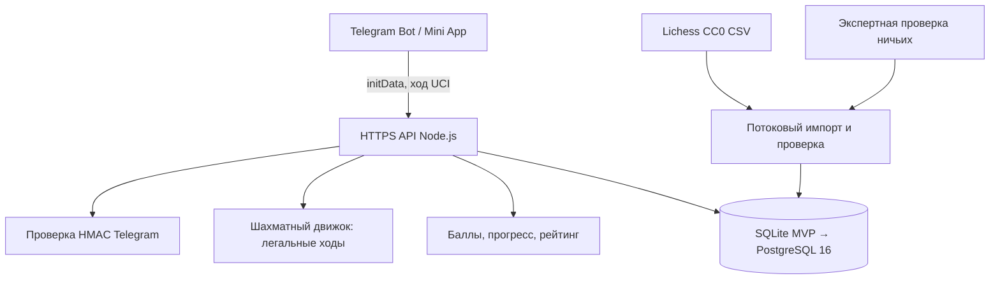

# Архитектура v0.1

## Принцип

Один изолированный продукт, **никаких общих таблиц или токенов** с существующими проектами. Frontend внутри Telegram — обычный HTML/JS Mini App. Telegram только средство входа и открытия приложения; проверка ходов, пользователи, баллы и задачи живут на собственном сервере.

## Данные

- `users`: UUID, Telegram ID, выбранное имя, opt-in рейтинга, очки, число решений, внутренний уровень.
- `sessions`: SHA-256 токена, привязка к пользователю, срок годности. Токен клиенту только при входе.
- `puzzles`: FEN, категория, рейтинг Lichess, проверенная линия UCI, источник, идентификатор, темы.
- `attempts`: попытка игрока, текущий FEN, число правильных полуходов, ошибки и подсказки.
- `completions`: **уникально (`user_id`, `puzzle_id`)**: итоговый балл за первое решение.

## Защита

- Проверять `initData`, `auth_date`, HMAC; не доверять полю Telegram user с клиента без HMAC.
- В рейтинге **нет** Telegram ID и других идентифицирующих сведений, только выбранный ник (после согласия).
- Выделить сервисного пользователя ОС, слушать localhost, наружу отдавать только HTTPS через обратный прокси.
- `DEV_MODE=0` в production, запрет на публичный демовход.
- Telegram webhook использует заголовок `X-Telegram-Bot-Api-Secret-Token`.
- Секреты в `.env` вне Git и в секрет-хранилище сервера. Действующие сервисы других проектов не менять.
- Для детей предпочитать псевдонимы, не собирать дату рождения, телефон, школу и реальные ФИО.

## Проверка задач

- Для `mate1` допустим любой ход, приводящий к мату, даже если он не записан в эталонной линии. Для финального хода матовой последовательности тоже принимается другой немедленный мат.
- Для `mate2` и `mate3` первая часть решения соответствует исходной версии Lichess; ход соперника проигрывается по эталону.
- Для `draw` равенства оценки недостаточно. Минимум: законная последовательность, терминальная ничья, метаданные экспертного одобрения и ссылка на подтверждение. **Пока по-настоящему проверенных задач такого типа нет**. Требуется дальнейшая методическая и движковая валидация.
- Импорт меток `equality` из Lichess в раздел `draw` запрещён.

## Обязательный production-этап

1. Перенести схему в PostgreSQL 16 с миграциями; ключи/уникальные ограничения сохранить.
2. Отдельный поддомен, TLS Caddy, systemd service, firewall, ежедневные бэкапы и проверка восстановления.
3. Бот и Mini App на отдельных переменных окружения, без существующих чат-ботов.
4. Подтвердить каталог как минимум 300/500/300/200 задач и ручную выборочную проверку.
5. Telegram end-to-end smoke test на iOS/Android/Desktop и двух разных аккаунтах.
